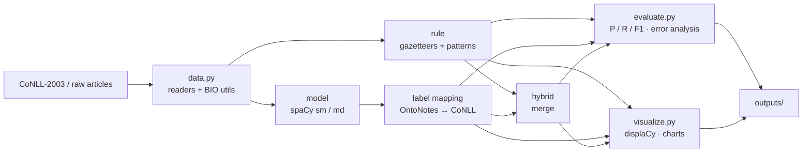

<div align="center">

# 🏷️ Named Entity Recognition for News Articles with spaCy

**Rule-based · Pre-trained model · Hybrid** NER on the CoNLL-2003 scheme (`PER` · `ORG` · `LOC` · `MISC`),
with entity-level evaluation, error analysis, displaCy visualisation, a CLI and a test suite.

[](https://github.com/salikhussain71-code/ner-news-articles-spacy/actions/workflows/ci.yml)


</div>

> **NLP internship - Task 4 (Level 2):** *Named Entity Recognition (NER) from News Articles*
> Dataset: CoNLL-2003 · Tools: Python, spaCy, Pandas · Topics: sequence labelling, NER

---

## Contents
[What this project does](#what-this-project-does) · [Task checklist](#task-checklist) · [How it works](#how-it-works) ·
[Quick start](#quick-start) · [Usage](#usage) · [Dataset](#dataset) · [Results](#results) ·
[Key finding](#key-finding-annotation-guidelines-matter) · [Project structure](#project-structure) ·
[Testing](#testing) · [Limitations](#limitations) · [License](#license)

## What this project does
Given news text, the system finds people, organisations, locations and miscellaneous named entities, and lets you
compare three ways of doing it on a labelled corpus:

| Approach | Idea | Strength |
|---|---|---|
| `rule` | gazetteers + token patterns (spaCy `PhraseMatcher` / `Matcher`) | transparent, instant, high precision on known names |
| `model` | pre-trained spaCy pipelines (`en_core_web_sm`, `en_core_web_md`) | generalises to unseen names |
| `hybrid` | model first, rules fill the gaps (or `hybrid-rules-first`) | best of both |

## Task checklist
| Requirement from the brief | Where |
|---|---|
| Dataset: CoNLL-2003 | `ner_news/data.py` (CoNLL text + Kaggle CSV readers, IOB1/IOB2) · [`docs/DATASET.md`](docs/DATASET.md) |
| Identify people, locations, organisations | all three approaches, CoNLL labels |
| Rule-based **and** model-based NER | `rules.py`, `models.py` |
| Highlight and categorise entities in the text | displaCy HTML + `entities.csv/json` (`extract` command) |
| Bonus: visualise with displaCy | `visualize.py` → `entities_displacy.html`, `comparison.html` |
| Bonus: compare two spaCy models | `en_core_web_sm` vs `en_core_web_md` in every evaluation |
| Tools: Python, spaCy, Pandas | yes (+ matplotlib for charts) |

## How it works

Details: [`docs/METHODOLOGY.md`](docs/METHODOLOGY.md) · label table: [`docs/LABEL_MAPPING.md`](docs/LABEL_MAPPING.md).

## Quick start
```bash
git clone https://github.com/salikhussain71-code/ner-news-articles-spacy.git
cd ner-news-articles-spacy

python -m venv .venv
# Windows (PowerShell):  .venv\Scripts\Activate.ps1      Windows (cmd): .venv\Scripts\activate.bat
# Linux / macOS:         source .venv/bin/activate

pip install -e ".[dev]"
python -m spacy download en_core_web_sm
python -m spacy download en_core_web_md

python -m ner_news demo        # extraction + visualisation + evaluation on the bundled sample
```
Open `outputs/visualizations/comparison.html` in a browser to see the approaches side by side.

## Usage
```bash
python -m ner_news info                                   # versions + installed models
python -m ner_news stats --data data/raw/conll2003/test.txt

# Evaluate on CoNLL-2003 (see Dataset) - writes CSVs, plots and evaluation_report.md
python -m ner_news evaluate --data data/raw/conll2003/test.txt \
       --output-dir outputs/evaluation_conll2003_test

# Extract entities from your own articles (blank line between articles)
python -m ner_news extract --input my_articles.txt --approach hybrid --model en_core_web_md
python -m ner_news extract --text "Dr. Ayesha Khan told Reuters that Microsoft will open an office in Lahore."
python -m ner_news extract --approach model --native-labels --text "..."   # spaCy's own 18 labels (DATE, MONEY, GPE...)

# Side-by-side HTML comparison
python -m ner_news visualize --input my_articles.txt
```

From Python:
```python
from ner_news.models import HybridRecognizer

rec = HybridRecognizer("en_core_web_sm")
doc = rec.analyze("President Smith met the World Bank in Geneva.")
print([(e.text, e.label_) for e in doc.ents])   # [('Smith', 'PER'), ('World Bank', 'ORG'), ('Geneva', 'LOC')]
```
A step-by-step notebook is in [`notebooks/01_ner_walkthrough.ipynb`](notebooks/01_ner_walkthrough.ipynb).

## Dataset
CoNLL-2003 (English, Reuters news) is **not** included because of its licence. Download it from Kaggle and place
`train.txt`, `valid.txt`, `test.txt` in `data/raw/conll2003/` - full instructions in [`docs/DATASET.md`](docs/DATASET.md).
A 15-sentence hand-annotated sample (`data/sample/`) is bundled so everything runs out of the box.

## Results

### Smoke test on the bundled sample (15 sentences, 45 entities)
> ⚠️ **Not a benchmark.** The sample is tiny and was written together with the gazetteers, so the rule-based and
> `hybrid-rules-first` scores are optimistic by construction. They only show that the pipeline works end to end.

| approach | precision | recall | F1 |
|---|---|---|---|
| hybrid-rules-first:en_core_web_md | 1.000 | 1.000 | 1.000 |
| hybrid-rules-first:en_core_web_sm | 1.000 | 1.000 | 1.000 |
| rule | 1.000 | 0.956 | 0.977 |
| hybrid:en_core_web_md | 0.956 | 0.956 | 0.956 |
| model:en_core_web_md | 0.956 | 0.956 | 0.956 |
| hybrid:en_core_web_sm | 0.911 | 0.911 | 0.911 |
| model:en_core_web_sm | 0.909 | 0.889 | 0.899 |

Full tables, per-type scores, error breakdown and plots: [`outputs/evaluation_sample/`](outputs/evaluation_sample/).

### CoNLL-2003 test set
Run the command below and paste the table from `outputs/evaluation_conll2003_test/evaluation_report.md` here:

```bash
python -m ner_news evaluate --data data/raw/conll2003/test.txt --output-dir outputs/evaluation_conll2003_test
```

| approach | precision | recall | F1 |
|---|---|---|---|
| *(run the command above and fill in)* | | | |

Scores are **entity-level exact match** (start, end and label must all match), identical to `conlleval` / `seqeval`
(the implementation was cross-checked against `seqeval`).

## Key finding: annotation guidelines matter
Pre-trained spaCy models are trained on **OntoNotes**, not CoNLL-2003. The error analysis (`error_details.csv`)
shows a systematic mismatch: the models often include a leading *the* in organisation names
(`the World Bank`) while CoNLL annotates only `World Bank`. On the sample this accounted for **9 of the
13 errors** of `en_core_web_sm`, so the project strips a leading *the/a/an* from model entities by default
(`--keep-determiners` turns this off for a raw comparison):

| model (sample only) | F1 with raw spans | F1 with determiners stripped |
|---|---|---|
| en_core_web_sm | 0.719 | 0.899 |
| en_core_web_md | 0.778 | 0.956 |

Remaining model errors on the sample are label-type disagreements (e.g. cities tagged `ORG`, a language tagged `LOC`).
Because of such guideline differences, always report which label mapping and normalisation were used.

## Project structure
```
ner-news-articles-spacy/
├── src/ner_news/
│   ├── data.py          # CoNLL / CSV readers, IOB1→IOB2, span utilities
│   ├── labels.py        # OntoNotes → CoNLL mapping, colours
│   ├── rules.py         # gazetteers + token patterns, overlap resolution
│   ├── models.py        # RuleRecognizer, SpacyRecognizer, HybridRecognizer
│   ├── evaluate.py      # entity-level P/R/F1, boundary F1, error analysis, reports
│   ├── extract.py       # entities → pandas DataFrame / CSV / JSON
│   ├── visualize.py     # displaCy HTML + matplotlib charts
│   ├── cli.py           # python -m ner_news {info,stats,evaluate,extract,visualize,demo}
│   └── resources/gazetteers/*.txt
├── tests/               # 47 tests (pytest)
├── data/{sample,raw}/   # bundled sample; put CoNLL-2003 in raw/
├── docs/                # METHODOLOGY, DATASET, LABEL_MAPPING
├── notebooks/           # 01_ner_walkthrough.ipynb
├── outputs/             # generated demo results
├── .github/workflows/ci.yml
├── pyproject.toml · requirements*.txt · Makefile · LICENSE · CITATION.cff
```

## Testing
```bash
pytest -q          # 47 tests: readers, BIO conversion, metrics, error analysis, rules, models, CLI
ruff check .       # lint
```
Model-dependent tests are skipped automatically if `en_core_web_sm` is not installed.
CI (GitHub Actions) runs lint + tests on Python 3.10-3.12.

## Limitations
* The rule gazetteers are small and hand-written; they cannot recognise unseen names, and ambiguous names
  (*Washington*, *Jordan*, *Apple*) get one fixed label regardless of context.
* The label mapping from OntoNotes to CoNLL is an approximation (sports teams, facilities, nationalities
  follow different guidelines).
* English only. No model is trained on CoNLL-2003 in this project - see *Possible extensions* in
  [`docs/METHODOLOGY.md`](docs/METHODOLOGY.md).

## References
* Tjong Kim Sang & De Meulder (2003). *Introduction to the CoNLL-2003 Shared Task: Language-Independent Named Entity Recognition.*
* [spaCy](https://spacy.io) - Explosion AI.

## License
[MIT](LICENSE) © 2026 Salik Hussain · GitHub: [@salikhussain71-code](https://github.com/salikhussain71-code)
